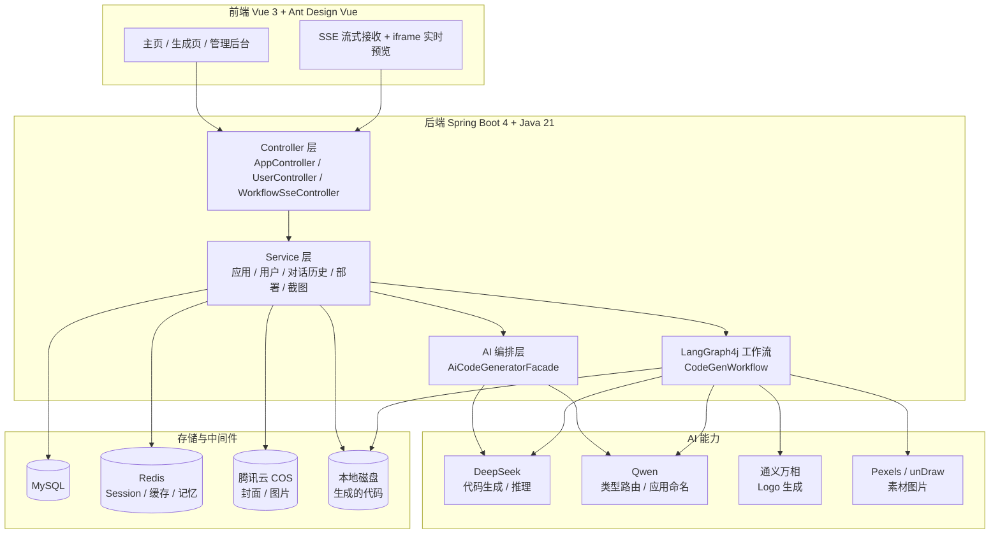
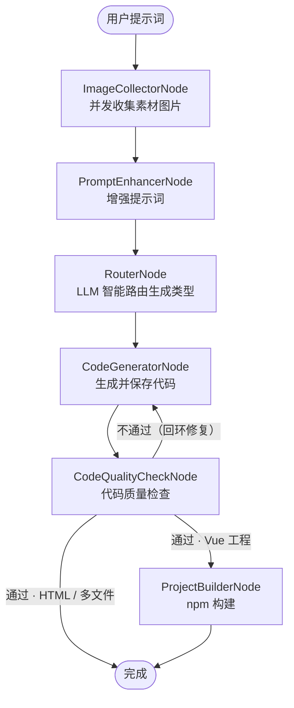

# 即刻AI · AI 应用生成平台

> 一句话描述需求，AI 自动生成并部署一个可访问的网页应用。

用户输入自然语言提示词，平台通过大模型自动**命名应用、路由生成类型、生成代码、质量检查、构建打包、一键部署**，全程 SSE 流式反馈实时进度。

---

## ✨ 核心特性

- **零代码生成应用**：一句提示词 → 可运行、可部署的网站
- **三种生成模式**：单文件 HTML、多文件（HTML/CSS/JS）、完整 Vue 3 工程，由 LLM 自动路由选择
- **Agent 化代码生成**：Vue 模式下模型通过文件读写工具（写/改/读/删/目录）自主创建整个工程
- **SSE 流式输出**：实时推送思考内容、工具调用、执行结果与构建进度，无长时间白屏
- **实时预览与部署**：iframe 实时预览，一键部署生成独立访问链接，自动截图作为封面
- **LangGraph4j 工作流**：素材收集 → 提示词增强 → 类型路由 → 代码生成 → 质量检查（可回环修复）→ 构建
- **多素材自动集成**：并发搜索配图（Pexels / unDraw）、AI 生成 Logo（通义万相）、Mermaid 架构图
- **企业级配套**：Redis 分布式限流、Prompt 注入安全护栏、Redis 会话与对话记忆、精选应用缓存

---

## 🧱 技术栈

| 分层 | 技术 |
|---|---|
| 前端 | Vue 3 · TypeScript · Ant Design Vue 4 · Pinia · Vite |
| 后端 | Spring Boot 4 · Java 21 · MyBatis-Flex |
| AI 编排 | LangChain4j 1.15 · LangGraph4j 1.8 |
| 大模型 | DeepSeek（代码生成）· Qwen（路由 / 命名）· 通义万相（Logo 生成） |
| 中间件 | MySQL · Redis（Session / 缓存 / 对话记忆）· Redisson（限流） |
| 存储/工具 | 腾讯云 COS · Selenium（网页截图）· Caffeine（本地缓存） |

---

## 🏗️ 系统架构



---

## 🔄 代码生成工作流

基于 **LangGraph4j** 的有状态工作流，质检不通过时自动**回环重新生成**，Vue 工程自动触发构建：



### 三种生成模式

| 类型 | 说明 | 产出 | 是否构建 |
|---|---|---|---|
| `html` | 单文件网页，适合简单页面 | `index.html` | ❌ |
| `multi_file` | 前后端分离的多文件页面 | `index.html` / `style.css` / `script.js` | ❌ |
| `vue_project` | 完整 Vue 3 工程，Agent 自主创建 | 整个工程目录 + `dist/` | ✅ npm install & build |

> 生成类型由 `RouterNode` 调用 Qwen 模型**自动判定**，用户无需手动选择。

---

## 📁 项目结构

```
jike-ai/
├── src/main/java/com/swl/jikeai/
│   ├── ai/                 # AI 服务接口、工厂、护栏、文件工具
│   ├── core/               # 代码生成门面：解析、保存、构建、流式处理
│   ├── langgraph4j/        # LangGraph4j 工作流、节点、状态、素材工具
│   ├── controller/         # 接口层（应用 / 用户 / 对话 / 工作流 / 静态资源）
│   ├── service/            # 业务层（应用 / 用户 / 部署 / 截图 / 对话历史）
│   ├── ratelimiter/        # Redisson 分布式限流（注解 + AOP）
│   ├── mapper/ model/      # MyBatis-Flex 持久层
│   └── config/             # Redis / COS / 模型 / 跨域等配置
├── src/main/resources/
│   ├── application.yml     # 主配置（模型 / 数据库 / 存储）
│   └── prompt/             # 各类系统提示词（代码生成 / 路由 / 质检 …）
└── jike-ai-frontend/       # Vue 3 前端工程
    └── src/
        ├── pages/          # 主页 / 生成页 / 管理后台
        ├── api/            # 由 OpenAPI 自动生成的接口层
        └── stores/ router/ # 状态管理与路由
```

---

## 🚀 快速开始

### 环境要求

- JDK **21+**、Maven 3.9+
- Node.js **20.19+ / 22.12+**
- MySQL 8+、Redis 6+

### 1. 启动后端

```bash
# 1) 创建数据库
mysql -u root -p -e "CREATE DATABASE jike_ai DEFAULT CHARSET utf8mb4;"

# 2) 在项目根目录创建 .env（参考下方环境变量），然后启动
./mvnw spring-boot:run
```

后端默认运行在 `http://localhost:8123`，接口前缀为 `/api`，Knife4j 接口文档：`http://localhost:8123/api/doc.html`。

### 2. 启动前端

```bash
cd jike-ai-frontend
npm install
npm run dev          # 默认 http://localhost:5173，已配置 /api 代理
```

### 3. 环境变量

在项目根目录 `.env` 中配置（**请勿提交到仓库**）：

```properties
DEEPSEEK_API_KEY=      # DeepSeek 密钥（代码生成）
DASHSCOPE_API_KEY=     # 阿里云百炼密钥（Qwen 路由 + 通义万相 Logo）
COS_SECRET_ID=         # 腾讯云 COS
COS_SECRET_KEY=        # 腾讯云 COS
PEXELS_API_KEY=        # Pexels 图片搜索
```

---

## 🔌 主要接口

| 方法 | 路径 | 说明 |
|---|---|---|
| `GET` | `/app/chat/gen/code` | **SSE** 对话式生成代码（限流 5 次/60 秒） |
| `POST` | `/app/add` | 创建应用（AI 自动命名 + 路由类型） |
| `POST` | `/app/deploy` | 部署应用，返回访问链接 |
| `GET` | `/app/download/{appId}` | 下载应用代码（ZIP） |
| `POST` | `/app/my/list/page/vo` | 我的应用分页 |
| `POST` | `/app/good/list/page/vo` | 精选应用分页（Redis 缓存） |
| `GET` | `/workflow/execute-sse` | **SSE** 执行 LangGraph4j 代码生成工作流 |
| `GET` | `/static/{deployKey}/**` | 访问已部署的应用 |

> 管理员接口以 `/app/admin/*` 开头，需 `admin` 角色。所有响应格式统一为 `{ code, data, message }`。

---

<details>
<summary><b>💡 核心设计：为什么需要「工具调用流式输出」</b></summary>

在 Vue 工程模式下，AI 通过文件工具（`FileWriteTool` 等）逐个创建文件。若只推送模型最后一轮的文本 token，则**中间的工具调用过程对前端不可见**：

```
[0s]     建立 SSE 连接
[0-120s] 模型反复调用 writeFile(...) → 后端静默执行 → 前端一片空白
[120s]   模型输出"项目已创建完毕" → 前端才开始显示文字
```

平台采用**结构化事件流**（`AiResponseMessage` / `AiThinkingMessage` / `ToolRequestMessage` / `ToolExecutedMessage`），把中间步骤也实时推送给前端：

```
🤔 正在分析需求...
📁 创建 App.vue ✅
📁 创建 router/index.js ✅
📁 创建 store/index.ts ✅
🎉 项目创建完毕！
```

| | 普通文本流 | 工具调用流式 |
|---|---|---|
| 前端体验 | 长时间白屏，结果突然出现 | 实时看到每个文件的创建进度 |
| 超时风险 | 高（工具多易触发网关超时） | 低（持续推送保持连接活跃） |

</details>
